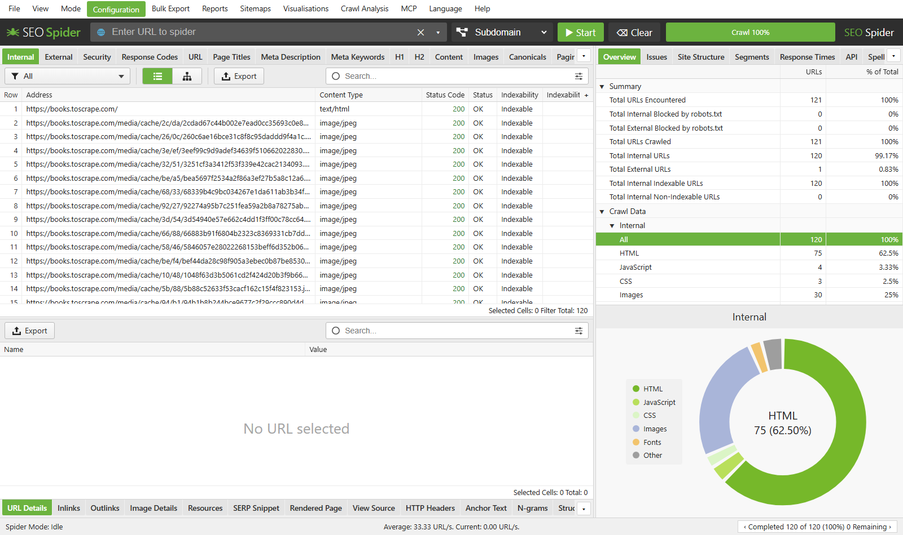
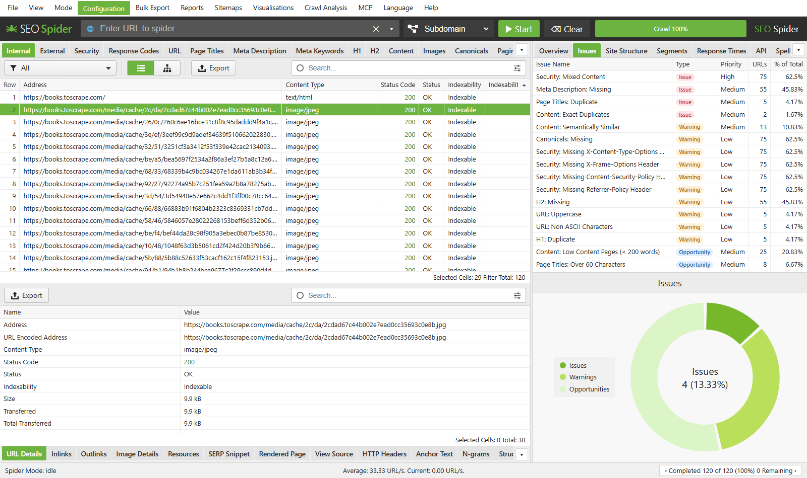
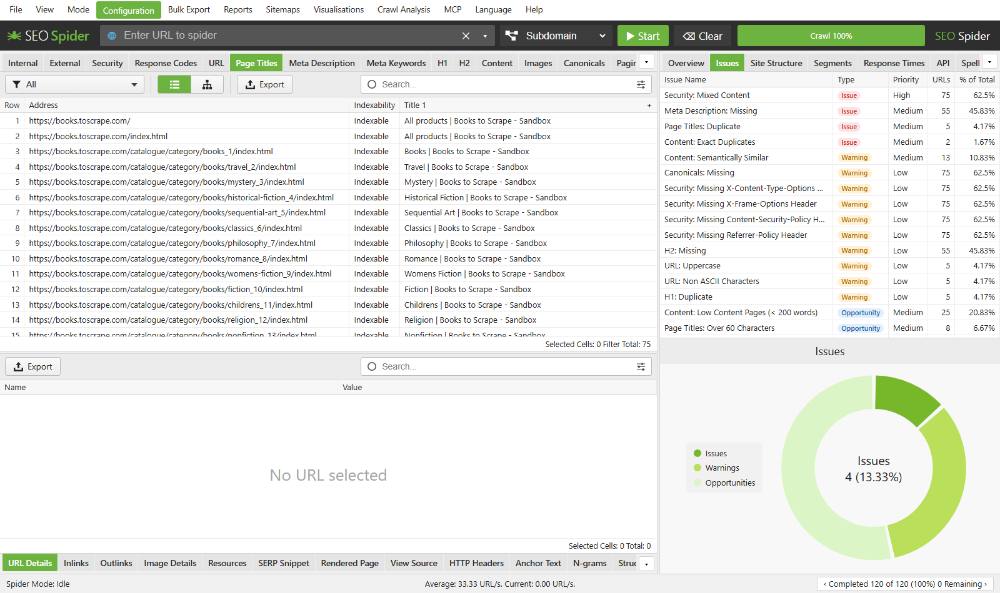
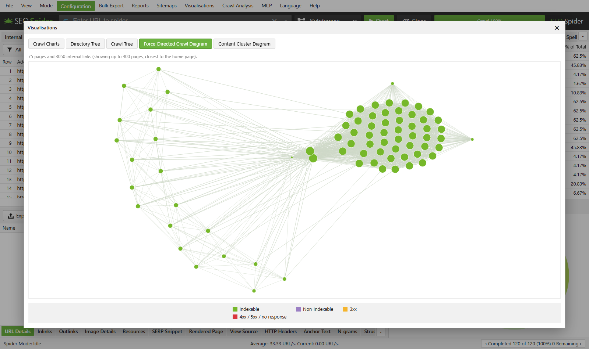
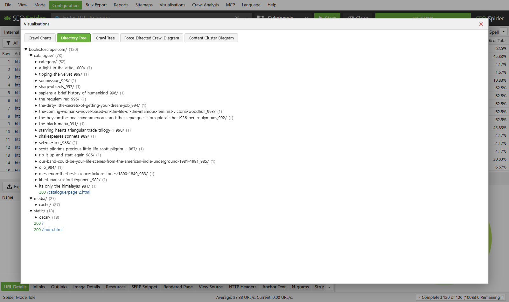
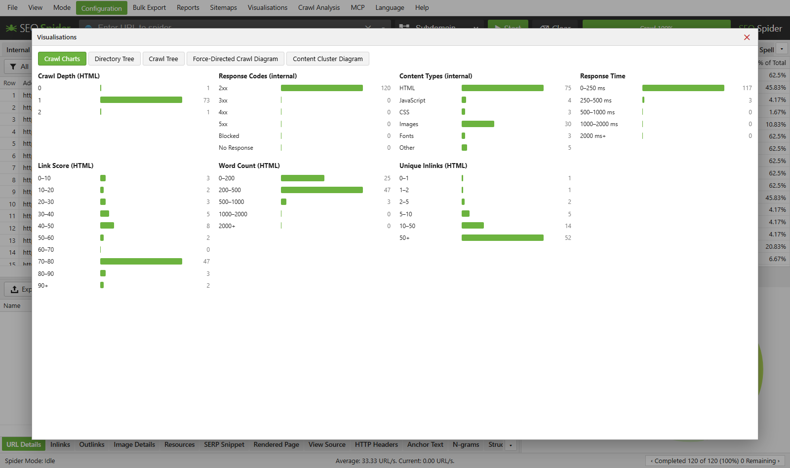

# SEO Spider


[Português](README.md) · **English** · [Español](README.es.md)

A technical SEO crawler that runs **100% locally** on your computer, inspired by the Screaming Frog
SEO Spider. Enter a URL and it walks the site like a search engine bot, then shows everything that
matters for SEO in a web interface: HTTP status, titles, meta descriptions, headings, canonicals,
broken links, redirects, duplicate content, structured data, security headers, accessibility and more.

Crawl data stays on your machine. Nothing is sent to third-party servers unless you connect an
integration (Google Search Console, GA4, PageSpeed, AI providers, etc.).



## What it does

### Crawling
- **Spider mode**: follows links from a start URL, scoped to the subdomain, a subfolder or all subdomains.
- **List mode**: crawls a pasted or imported list of URLs.
- Respects `robots.txt` (Google's rules, RFC 9309) and `Crawl-delay`, with a robots.txt tester that shows which line allowed or blocked each URL.
- XML sitemap reading, regex include/exclude filters, parameter stripping (`utm_*`, `gclid`…).
- **JavaScript rendering** with Chromium (Playwright) and raw vs. rendered HTML comparison.
- WAF block handling (Cloudflare, Akamai…) with a real-browser fallback.
- Basic auth, form-based login, custom headers and cookies, proxy and configurable User-Agent.
- Limits for URL count, depth, concurrency and requests per second.

### SEO analysis
- Screaming Frog–style tabs: Internal, External, Security, Response Codes, URL, Page Titles, Meta Description, Meta Keywords, H1, H2, Content, Images, Canonicals, Pagination, Hreflang, Structured Data, Links and more.
- **Issues panel** classified as *Issues*, *Warnings* and *Opportunities*, with priority.
- Pixel width of titles and descriptions (as shown on Google) and a **SERP snippet** preview.
- **Exact and near-duplicate** content (MinHash) and **semantic similarity** between pages.
- Redirect and canonical chains, orphan pages, HTTP/HTTPS mixed content.
- **Structured data** (JSON-LD) validation against the schema.org vocabulary.
- **Accessibility** audit with axe-core.
- Spelling and grammar, n-grams, internal link score.
- **Custom extraction** via CSS, XPath or regex with a visual inspector, plus custom JavaScript.

### Visualizations
Force-directed link diagram, directory tree, crawl tree, crawl charts and content clusters.

### Integrations (optional)
Google Search Console, Google Analytics 4, PageSpeed Insights, Majestic, Ahrefs, Moz and AI providers
(OpenAI, Anthropic, Gemini, local Ollama) to enrich each URL with metrics or generate summaries.

### Reports and automation
- Export to **Excel (.xlsx)** and CSV, bulk exports and reports (overview, redirects, orphans, migration, accessibility…).
- **XML sitemap** generation.
- Auto-saved crawls, reopening past crawls and **crawl comparison** (change detection).
- Crawl **scheduling** and a **command-line interface** (CLI) for headless runs.
- **MCP** server to query crawl data from AI assistants.
- Interface in **Portuguese, English and Spanish**.

## Screenshots

**Issues found on the site**


**Page Titles tab**


**Internal link diagram**


**Directory tree**


**Crawl charts**


> Screenshots show a demo crawl of `books.toscrape.com`, a public site made for scraping practice. The interface language can be switched in the **Language** menu (Português, English, Español).

## Running it

Requirements: **Python 3.10+** (tested on 3.13) on Windows, Linux or macOS.

### Quick start (Windows)
Double-click `run.bat`. It creates the virtual environment, installs dependencies, starts the server and
opens <http://127.0.0.1:8765> in your browser.

### Quick start (Linux/macOS)
From the project directory, run:
```bash
./run.sh
```
The script creates the virtual environment, installs dependencies, opens the browser when
`xdg-open` or `open` is available, and starts the server at <http://127.0.0.1:8765>.
If the browser opens before the server is ready, refresh the page.

### Manual (Windows)
```bash
python -m venv .venv
.venv\Scripts\activate
pip install -r requirements.txt
python -m playwright install chromium   # optional: JS rendering, accessibility and WAF fallback
python -m uvicorn app:app --host 127.0.0.1 --port 8765
```
Then open <http://127.0.0.1:8765>, enter a URL and click **Start**.

### Command line
```bash
cli.bat https://www.example.com --export xlsx,issues --output D:/reports
cli.bat --list urls.txt --export xlsx --lang en
cli.bat https://www.example.com --project site --compare-previous
```
Run `cli.bat --help` for all export kinds.

## Integrations and API keys

Keys (OpenAI, Anthropic, Gemini, Google, etc.) are entered in the interface under **Configuration**
and are stored only in `data/integrations.json` on your computer. The `data/` folder is in
`.gitignore` and **is never pushed to the repository**. The server listens only on `127.0.0.1`,
so it is not exposed to the network.

## Tests
```bash
tests.bat          # fast suite (unittest, no extra dependencies)
tests.bat full     # suite + regression check with a real crawl
```
Details in [tests/README.en.md](tests/README.en.md).

## Structure

| File | Purpose |
|---|---|
| `app.py` | FastAPI server: API, exports, reports, schedules and MCP |
| `crawler.py` | Async crawler (httpx + Playwright) and SEO data extraction |
| `analysis.py` | Issue rules, duplicates, pixel widths, schema.org, similarity |
| `integrations.py` | GSC, GA4, PageSpeed, Majestic, Ahrefs, Moz and AI providers |
| `robots.py` | robots.txt parser following Google's rules |
| `storage.py` | Saved crawls (gzipped JSON) and crawl comparison |
| `extraction.py` | Visual inspector for custom extraction |
| `waf_fallback.py` | Browser fallback when a WAF blocks the request |
| `cli.py` | Command-line crawling |
| `static/` | Web interface (HTML, CSS, JS) and translations |

## Contributing
Contributions are very welcome! Bug fixes, new SEO checks, translations and documentation.
Read the [contributing guide](CONTRIBUTING.md#english) and look for issues labeled
[`good first issue`](https://github.com/PChiovatto/seo-spider/issues?q=is%3Aopen+label%3A%22good+first+issue%22) to get started.

## License
[MIT](LICENSE) © 2026 Paulo Chiovatto

## Disclaimer
Independent project, not affiliated with Screaming Frog Ltd. Only crawl sites you are allowed to
analyze, and respect their request limits.
