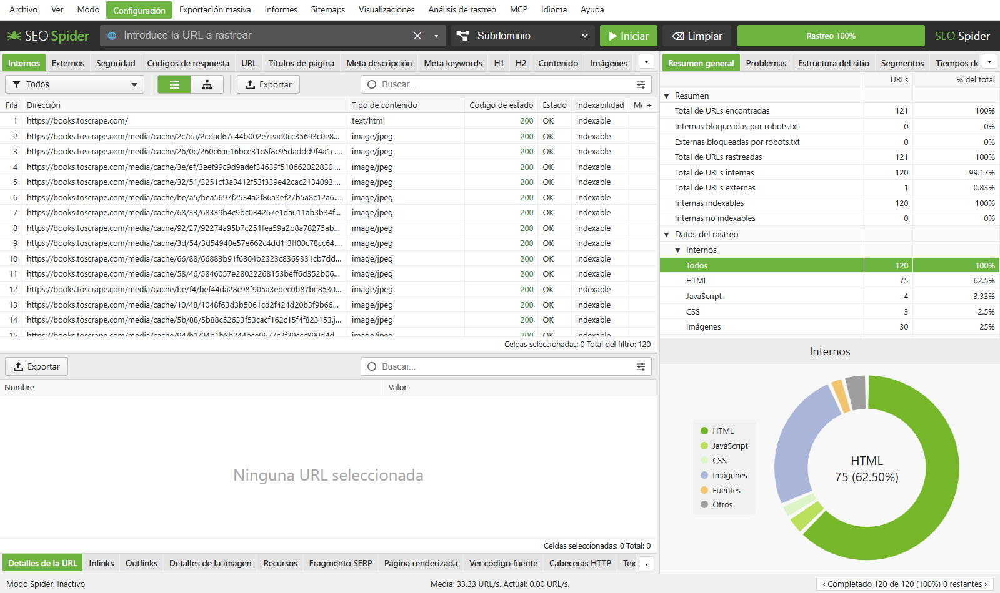
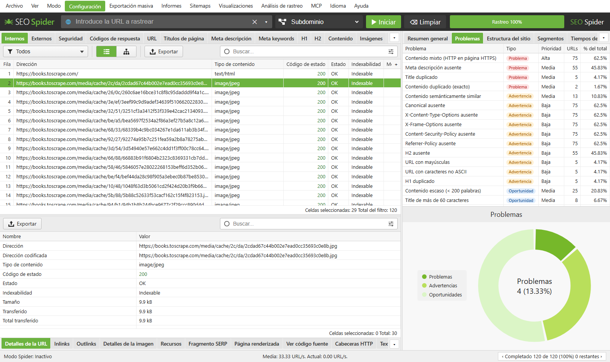
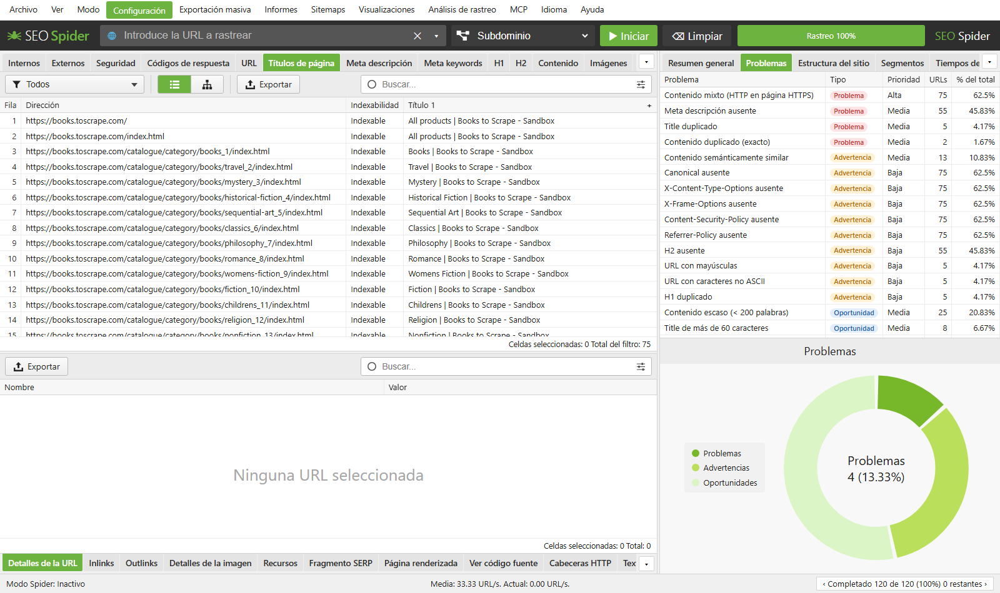
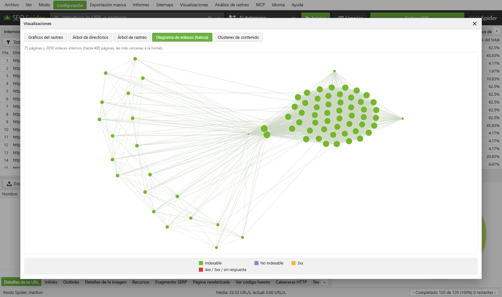
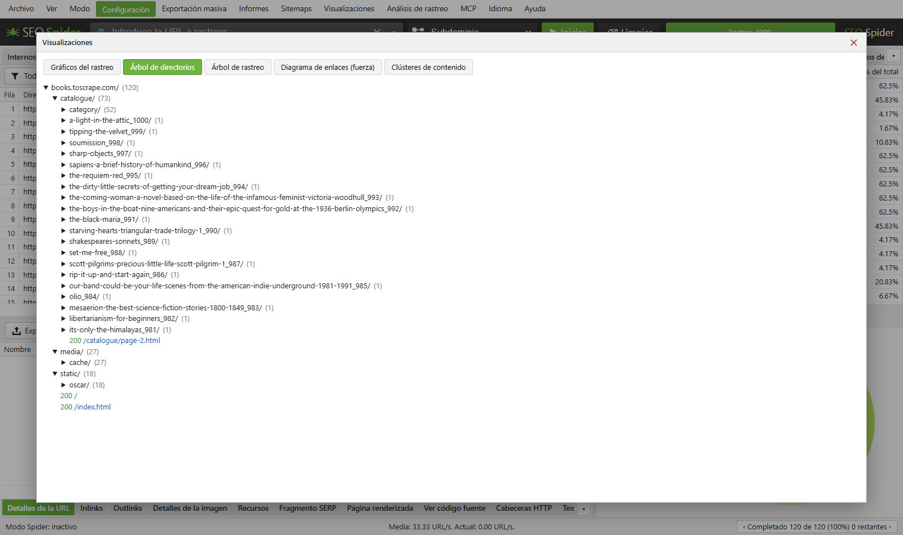
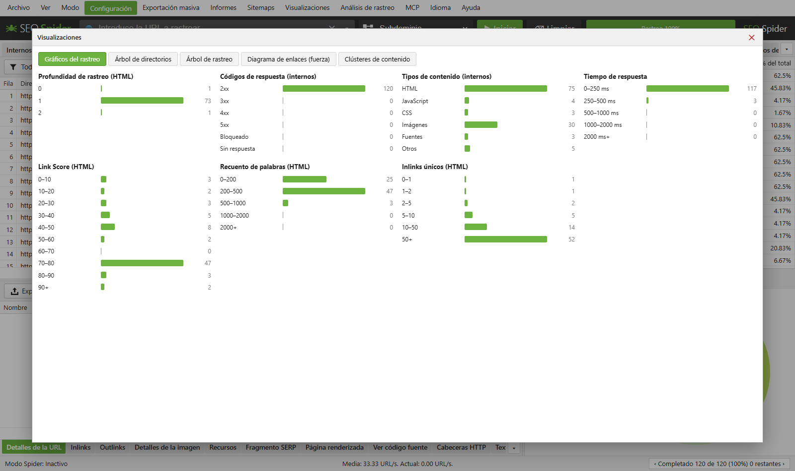

# SEO Spider


[Português](README.md) · [English](README.en.md) · **Español**

Rastreador (crawler) de SEO técnico que se ejecuta **100% en local** en tu computadora, inspirado en
Screaming Frog SEO Spider. Ingresas una URL, recorre el sitio como un robot de búsqueda y muestra en una
interfaz web todo lo que importa para el SEO: estado HTTP, títulos, meta descriptions, encabezados,
canonicals, enlaces rotos, redirecciones, contenido duplicado, datos estructurados, cabeceras de
seguridad, accesibilidad y mucho más.

Los datos del rastreo se quedan en tu equipo. No se envía nada a servidores de terceros, salvo que
conectes una integración (Google Search Console, GA4, PageSpeed, IA, etc.).



## Qué hace

### Rastreo
- **Modo Spider**: sigue los enlaces desde una URL inicial, con alcance por subdominio, subcarpeta o todos los subdominios.
- **Modo Lista**: rastrea una lista de URLs pegada o importada.
- Respeta `robots.txt` (reglas de Google, RFC 9309) y `Crawl-delay`, con un probador de robots.txt que indica qué línea permitió o bloqueó cada URL.
- Lectura de sitemaps XML, filtros de inclusión/exclusión por regex, eliminación de parámetros (`utm_*`, `gclid`…).
- **Renderizado de JavaScript** con Chromium (Playwright) y comparación HTML original × renderizado.
- Manejo de bloqueos de WAF (Cloudflare, Akamai…) con respaldo en un navegador real.
- Autenticación básica, login por formulario, cabeceras y cookies personalizadas, proxy y User-Agent configurable.
- Límites de URLs, profundidad, concurrencia y solicitudes por segundo.

### Análisis SEO
- Pestañas al estilo de Screaming Frog: Internos, Externos, Seguridad, Códigos de respuesta, URL, Page Titles, Meta Description, Meta Keywords, H1, H2, Contenido, Imágenes, Canonicals, Paginación, Hreflang, Datos estructurados, Enlaces, entre otras.
- **Panel de Problemas** clasificados en *Issues*, *Warnings* y *Oportunidades*, con prioridad.
- Ancho en píxeles de títulos y descriptions (como aparecen en Google) y vista previa del **SERP Snippet**.
- Contenido **duplicado exacto y casi duplicado** (MinHash) y **similitud semántica** entre páginas.
- Cadenas de redirección y de canonical, páginas huérfanas, contenido mixto HTTP/HTTPS.
- Validación de **datos estructurados** (JSON-LD) contra el vocabulario de schema.org.
- Auditoría de **accesibilidad** con axe-core.
- Ortografía y gramática, n-gramas, link score interno.
- **Extracción personalizada** por CSS, XPath o regex, con inspector visual, y ejecución de JavaScript personalizado.

### Visualizaciones
Diagrama de enlaces por fuerzas, árbol de directorios, árbol de rastreo, gráficos del rastreo y clusters de contenido.

### Integraciones (opcionales)
Google Search Console, Google Analytics 4, PageSpeed Insights, Majestic, Ahrefs, Moz y proveedores de IA
(OpenAI, Anthropic, Gemini, Ollama local) para enriquecer cada URL con métricas o generar resúmenes.

### Informes y automatización
- Exportación a **Excel (.xlsx)** y CSV, exportaciones masivas e informes (resumen, redirecciones, huérfanas, migración, accesibilidad…).
- Generación de **sitemap XML**.
- Rastreos guardados automáticamente, apertura de rastreos anteriores y **comparación entre rastreos** (detección de cambios).
- **Programación** de rastreos e **interfaz de línea de comandos** (CLI) para ejecutar sin interfaz.
- Servidor **MCP** para consultar los datos del rastreo desde asistentes de IA.
- Interfaz en **portugués, inglés y español**.

## Capturas de pantalla

**Problemas encontrados en el sitio**


**Pestaña Títulos de página**


**Diagrama de enlaces internos**


**Árbol de directorios**


**Gráficos del rastreo**


> Las capturas muestran un rastreo de demostración de `books.toscrape.com`, un sitio público creado para practicar scraping. El idioma de la interfaz se puede cambiar en el menú **Idioma** (Português, English, Español).

## Cómo ejecutarlo

Requisitos: **Python 3.10+** (probado en 3.13) en Windows, Linux o macOS.

### Forma rápida (Windows)
Haz doble clic en `run.bat`. Crea el entorno virtual, instala las dependencias, inicia el servidor y abre
<http://127.0.0.1:8765> en el navegador.

### Forma rápida (Linux/macOS)
Desde la carpeta del proyecto, ejecuta:
```bash
./run.sh
```
El script crea el entorno virtual, instala las dependencias, abre el navegador cuando
`xdg-open` u `open` está disponible e inicia el servidor en <http://127.0.0.1:8765>.
Si el navegador se abre antes de que el servidor esté listo, actualiza la página.

### Manual (Windows)
```bash
python -m venv .venv
.venv\Scripts\activate
pip install -r requirements.txt
python -m playwright install chromium   # opcional: renderizado JS, accesibilidad y respaldo ante WAF
python -m uvicorn app:app --host 127.0.0.1 --port 8765
```
Luego abre <http://127.0.0.1:8765>, escribe la URL y haz clic en **Iniciar**.

### Línea de comandos
```bash
cli.bat https://www.example.com --export xlsx,issues --output D:/informes
cli.bat --list urls.txt --export xlsx --lang es
cli.bat https://www.example.com --project sitio --compare-previous
```
Ejecuta `cli.bat --help` para ver todos los tipos de exportación.

## Integraciones y claves de API

Las claves (OpenAI, Anthropic, Gemini, Google, etc.) se ingresan en la propia interfaz, en el menú
**Configuración**, y se guardan solo en `data/integrations.json` en tu computadora. La carpeta `data/`
está en `.gitignore` y **nunca se sube al repositorio**. El servidor escucha solo en `127.0.0.1`,
por lo que no queda expuesto en la red.

## Pruebas
```bash
tests.bat          # suite rápida (unittest, sin dependencias extra)
tests.bat full     # suite + verificación de regresión con un rastreo real
```
Detalles en [tests/README.md](tests/README.md) (en portugués).

## Estructura

| Archivo | Función |
|---|---|
| `app.py` | Servidor FastAPI: API, exportaciones, informes, programaciones y MCP |
| `crawler.py` | Crawler asíncrono (httpx + Playwright) y extracción de datos SEO |
| `analysis.py` | Reglas de problemas, duplicados, ancho en píxeles, schema.org, similitud |
| `integrations.py` | GSC, GA4, PageSpeed, Majestic, Ahrefs, Moz y proveedores de IA |
| `robots.py` | Parser de robots.txt según las reglas de Google |
| `storage.py` | Rastreos guardados (JSON gzip) y comparación entre rastreos |
| `extraction.py` | Inspector visual de extracción personalizada |
| `waf_fallback.py` | Respaldo con navegador cuando un WAF bloquea la solicitud |
| `cli.py` | Rastreo por línea de comandos |
| `static/` | Interfaz web (HTML, CSS, JS) y traducciones |

## Contribuir
¡Las contribuciones son muy bienvenidas! Correcciones, nuevas verificaciones SEO, traducciones y documentación.
Lee la [guía de contribución](CONTRIBUTING.md#español) y busca issues etiquetados como
[`good first issue`](https://github.com/PChiovatto/seo-spider/issues?q=is%3Aopen+label%3A%22good+first+issue%22) para empezar.

## Licencia
[MIT](LICENSE) © 2026 Paulo Chiovatto

## Aviso
Proyecto independiente, sin vínculo con Screaming Frog Ltd. Rastrea solo sitios que tengas permiso
para analizar y respeta sus límites de solicitudes.
