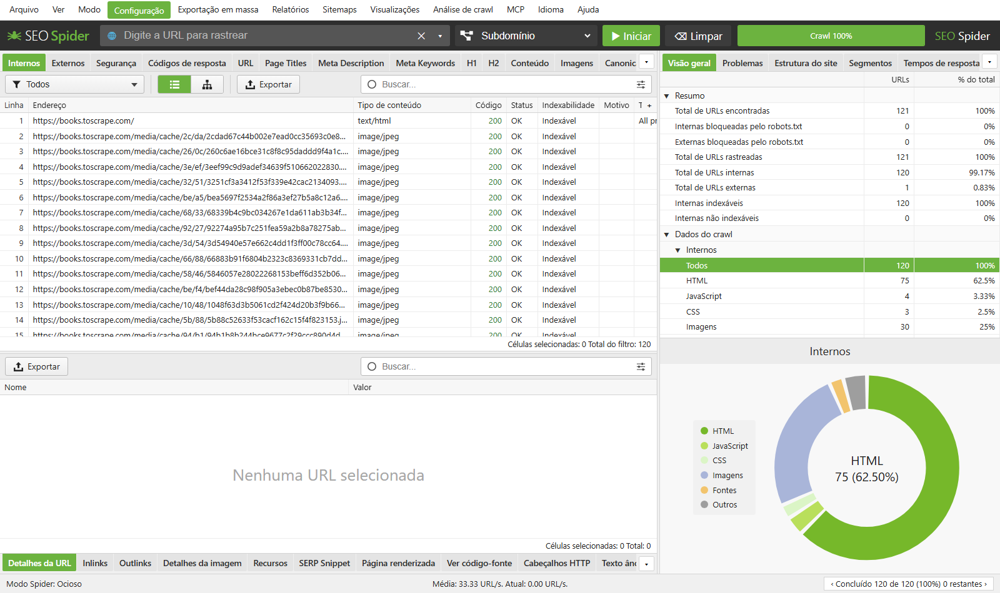
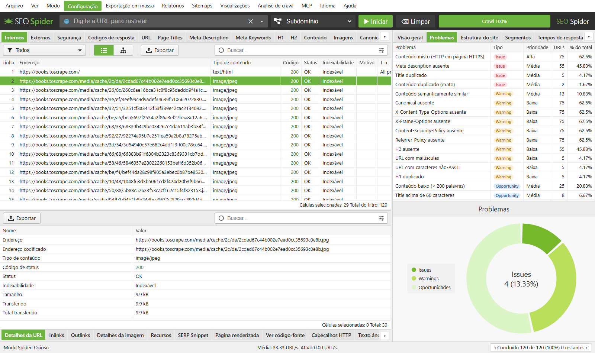
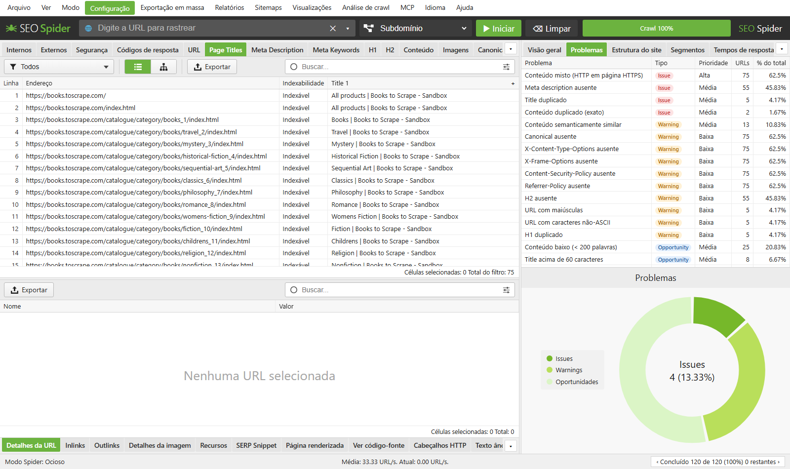
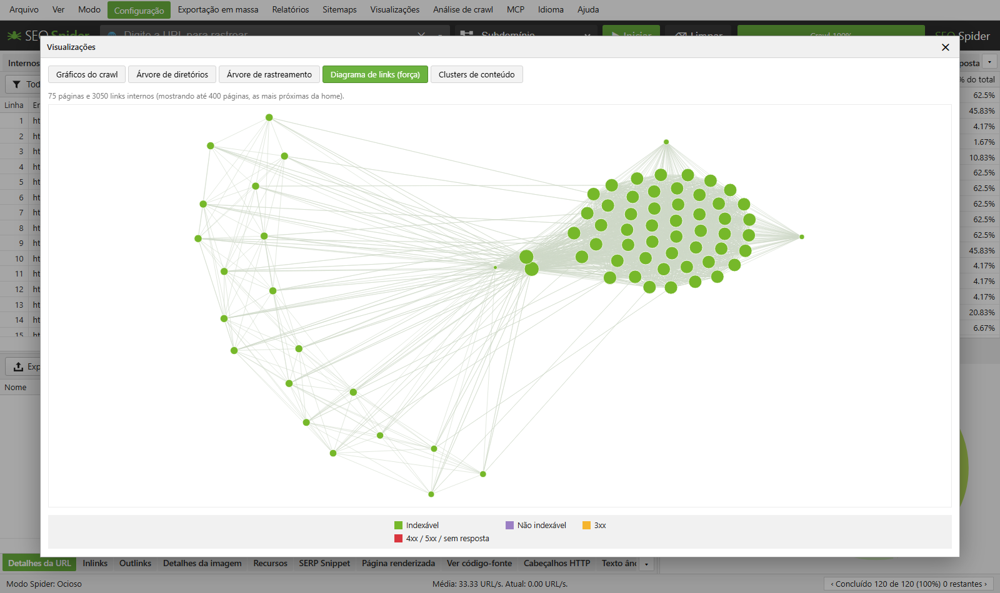
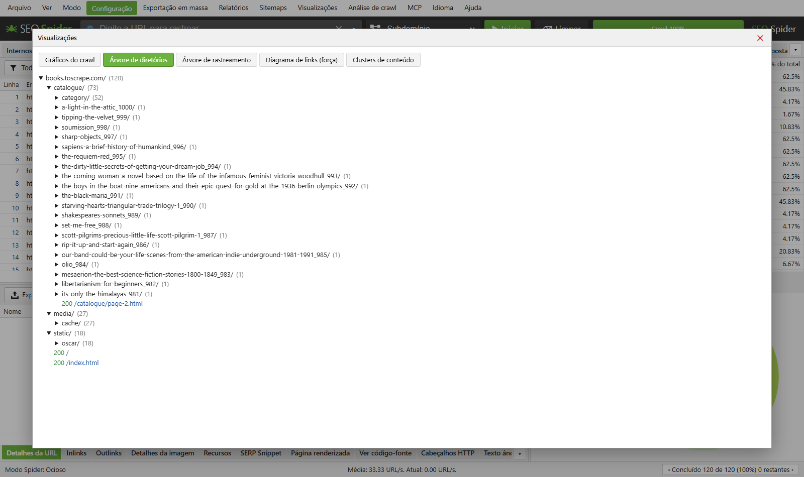
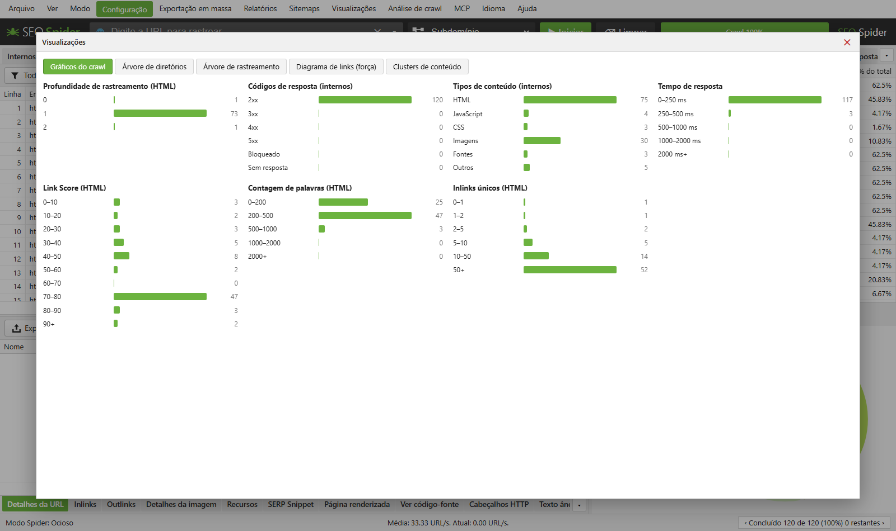

# SEO Spider

**Português** · [English](README.en.md) · [Español](README.es.md)

Rastreador (crawler) de SEO técnico que roda **100% local** no seu computador, inspirado no
Screaming Frog SEO Spider. Você informa uma URL, ele percorre o site como um robô de busca e
mostra numa interface web tudo o que importa para SEO: status HTTP, títulos, meta descriptions,
headings, canonicals, links quebrados, redirecionamentos, conteúdo duplicado, dados estruturados,
cabeçalhos de segurança, acessibilidade e muito mais.

Os dados do crawl ficam na sua máquina. Nada é enviado para servidores de terceiros, a não ser
que você conecte uma integração (Google Search Console, GA4, PageSpeed, IA etc.).



## O que ele faz

### Rastreamento
- **Modo Spider**: segue os links a partir de uma URL inicial, com escopo por subdomínio, subpasta ou todos os subdomínios.
- **Modo Lista**: rastreia uma lista de URLs colada ou importada.
- Respeita `robots.txt` (regras do Google, RFC 9309) e `Crawl-delay`, com testador de robots.txt que mostra qual linha liberou ou bloqueou cada URL.
- Leitura de sitemaps XML, filtros de inclusão/exclusão por regex, remoção de parâmetros (`utm_*`, `gclid`…).
- **Renderização de JavaScript** com Chromium (Playwright) e comparação HTML bruto × renderizado.
- Contorno de bloqueios de WAF (Cloudflare, Akamai…) com fallback para navegador real.
- Autenticação básica, login por formulário, cabeçalhos e cookies customizados, proxy e User-Agent configurável.
- Limite de URLs, profundidade, concorrência e requisições por segundo.

### Análise de SEO
- Abas no estilo do Screaming Frog: Internos, Externos, Segurança, Códigos de resposta, URL, Page Titles, Meta Description, Meta Keywords, H1, H2, Conteúdo, Imagens, Canonicals, Paginação, Hreflang, Dados estruturados, Links, entre outras.
- **Painel de Problemas** classificados em *Issues*, *Warnings* e *Oportunidades*, com prioridade.
- Largura em pixels de títulos e descriptions (como aparecem no Google) e prévia de **SERP Snippet**.
- Conteúdo **duplicado exato e quase-duplicado** (MinHash) e **similaridade semântica** entre páginas.
- Cadeias de redirecionamento e de canonical, páginas órfãs, conteúdo misto HTTP/HTTPS.
- Validação de **dados estruturados** (JSON-LD) contra o vocabulário schema.org.
- Auditoria de **acessibilidade** com axe-core.
- Ortografia e gramática, *n-grams*, link score interno.
- **Extração customizada** por CSS, XPath ou regex, com inspetor visual, e execução de JavaScript customizado.

### Visualizações
Diagrama de links por força, árvore de diretórios, árvore de rastreamento, gráficos do crawl e clusters de conteúdo.

### Integrações (opcionais)
Google Search Console, Google Analytics 4, PageSpeed Insights, Majestic, Ahrefs, Moz e provedores de IA
(OpenAI, Anthropic, Gemini, Ollama local) para enriquecer cada URL com métricas ou gerar resumos.

### Relatórios e automação
- Exportação para **Excel (.xlsx)** e CSV, exportações em massa e relatórios (visão geral, redirecionamentos, órfãs, migração, acessibilidade…).
- Geração de **sitemap XML**.
- Crawls salvos automaticamente, abertura de crawls anteriores e **comparação entre crawls** (detecção de mudanças).
- **Agendamento** de crawls e **linha de comando** (CLI) para rodar sem interface.
- Servidor **MCP** para consultar os dados do crawl a partir de assistentes de IA.
- Interface em **português, inglês e espanhol**.

## Capturas de tela

**Problemas encontrados no site**


**Aba Page Titles**


**Diagrama de links internos**


**Árvore de diretórios**


**Gráficos do crawl**


> As capturas mostram um crawl de demonstração de `books.toscrape.com`, site público feito para testes de scraping. O idioma da interface pode ser trocado no menu **Idioma** (Português, English, Español).

## Como rodar

Requisitos: **Python 3.10+** (testado no 3.13) em Windows, Linux ou macOS.

### Jeito rápido (Windows)
Dê dois cliques em `run.bat`. Ele cria o ambiente virtual, instala as dependências, inicia o servidor e abre
<http://127.0.0.1:8765> no navegador.

### Jeito rápido (Linux/macOS)
Na pasta do projeto, execute:
```bash
./run.sh
```
O script cria o ambiente virtual, instala as dependências, abre o navegador quando
`xdg-open` ou `open` está disponível e inicia o servidor em <http://127.0.0.1:8765>.
Se o navegador abrir antes de o servidor estar pronto, atualize a página.

### Manual (Windows)
```bash
python -m venv .venv
.venv\Scripts\activate
pip install -r requirements.txt
python -m playwright install chromium   # opcional: renderização JS, acessibilidade e fallback de WAF
python -m uvicorn app:app --host 127.0.0.1 --port 8765
```
Depois abra <http://127.0.0.1:8765>, digite a URL e clique em **Iniciar**.

### Linha de comando
```bash
cli.bat https://www.example.com --export xlsx,issues --output D:/relatorios
cli.bat --list urls.txt --export xlsx --lang en
cli.bat https://www.example.com --project site --compare-previous
```
Rode `cli.bat --help` para ver todos os tipos de exportação.

## Configuração das integrações e chaves de API

As chaves (OpenAI, Anthropic, Gemini, Google etc.) são informadas pela própria interface, no menu
**Configuração**, e ficam gravadas apenas em `data/integrations.json` no seu computador.
A pasta `data/` está no `.gitignore` e **nunca é enviada ao repositório**. O servidor escuta só em
`127.0.0.1`, então não fica exposto na rede.

## Testes
```bash
tests.bat          # suíte rápida (unittest, sem dependências extras)
tests.bat full     # suíte + verificação de regressão com crawl real
```
Detalhes em [tests/README.md](tests/README.md).

## Estrutura

| Arquivo | Função |
|---|---|
| `app.py` | Servidor FastAPI: API, exportações, relatórios, agendamentos e MCP |
| `crawler.py` | Crawler assíncrono (httpx + Playwright) e extração dos dados de SEO |
| `analysis.py` | Regras de problemas, duplicados, largura em pixels, schema.org, similaridade |
| `integrations.py` | GSC, GA4, PageSpeed, Majestic, Ahrefs, Moz e provedores de IA |
| `robots.py` | Parser de robots.txt nas regras do Google |
| `storage.py` | Crawls salvos (JSON gzip) e comparação entre crawls |
| `extraction.py` | Inspetor visual de extração customizada |
| `waf_fallback.py` | Fallback para navegador quando um WAF bloqueia a requisição |
| `cli.py` | Crawl pela linha de comando |
| `static/` | Interface web (HTML, CSS, JS) e traduções |

## Contribuindo
Contribuições são muito bem-vindas! Correções, novas verificações de SEO, traduções e documentação.
Leia o [guia de contribuição](CONTRIBUTING.md) e procure issues marcadas com
[`good first issue`](https://github.com/PChiovatto/seo-spider/issues?q=is%3Aopen+label%3A%22good+first+issue%22) para começar.

## Licença
[MIT](LICENSE) © 2026 Paulo Chiovatto

## Aviso
Projeto independente, sem vínculo com a Screaming Frog Ltd. Rastreie apenas sites que você tem
permissão para analisar e respeite os limites de requisição deles.
